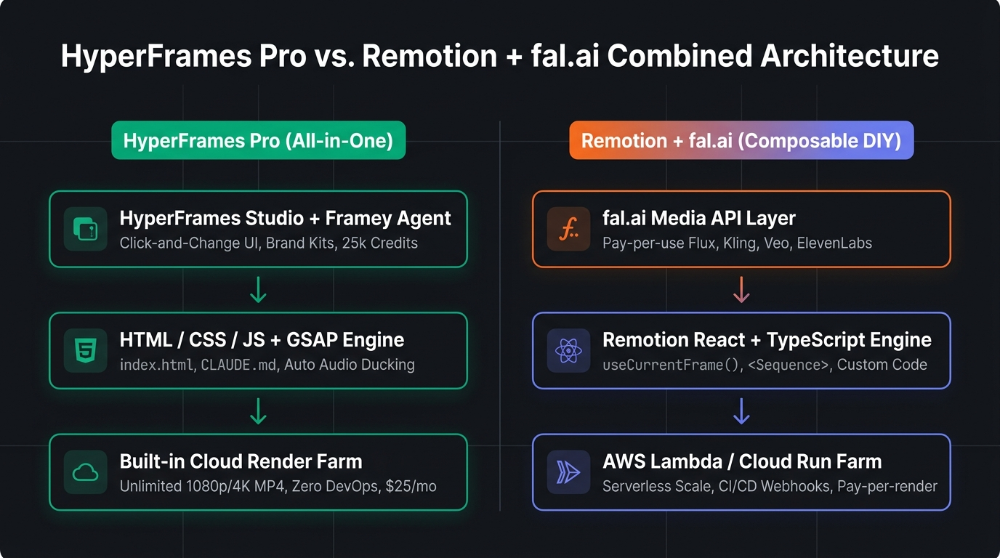

# HyperFrames Pro — Complete Usage Guide, All Features & Remotion + fal.ai Comparison

> **Live Interactive Showcase (GitHub Pages):** https://rifaterdemsahin.github.io/hyperframes-pro/
> **Quick Install Guide:** See [`INSTALL.md`](INSTALL.md) (`claude plugin marketplace add heygen-com/hyperframes` & `npx skills add heygen-com/hyperframes`)

## Overview
HyperFrames is an advanced rendering and editing orchestration engine that treats **video as code**. Instead of manually dragging clips in a traditional timeline editor, HyperFrames allows you to use AI coding agents (like Framey and Claude Code) to programmatically generate, sequence, and render final MP4 videos using standard **HTML, CSS, JavaScript, and GSAP animations**.

The **HyperFrames Pro Plan (£19 / $25 per month)** provides a consolidated workspace for automated video production, combining 25,000 monthly media generation credits, premium video/voice models, and **unlimited offloaded cloud rendering** to maximize parallel workflows and preserve local hardware resources.

---

## Step-by-Step Guide: How to Use HyperFrames Pro

### Phase 1: Workspace Setup, Brand Kits & 4-Beat Prompting
1. **Configure a Brand Kit:** Define your brand colors, fonts, and logo tokens so every generated scene inherits consistent styling.
2. **Browse Inspirations or Academy:** Pick a starting template from the **1,000+ Inspirations** library or complete a 2-minute **Pit Crew Academy** interactive lesson inside *Learn HyperFrames* to learn precise motion prompts (e.g., *"cursor drag, hard cut, staggered pop with overshoot"*).
3. **Compose Your 4-Beat Prompt:** Use the **"Your first video"** composer to structure your script into **Hook → Proof → Turn → Call to action**. Manage up to **20 active cloud projects** simultaneously.

### Phase 2: Storyboarding, Fact-Checking & Reference Acceleration
1. **Audit `STORYBOARD.md`:** Framey outlines scene-by-scene timing and flags statistics with *"verify before air"* citations so you can verify facts before burning render credits.
2. **Accelerate with Reference Tools:**
   - Run **`/reverse-any-video`** to decompile an existing reference video into an editable HyperFrames HTML/GSAP project.
   - Use **Video Match** to generate a new video matching the pacing and visual style of a clip you like.
   - Pull visuals via built-in **image/footage search** and isolate subjects with **unlimited background removal**.

### Phase 3: HTML Compilation & Click-and-Change Layer Editing
1. **Build the Video:** Click **"Build the video"**—Framey (powered by **Claude Sonnet 5.5**) compiles posed HTML scenes into `index.html` and `boards/`.
2. **Respect the Concurrency Lock:** While `Working | Locked` is shown on the timeline, let Framey finish mutating code/clips safely.
3. **Direct Canvas Manipulation:**
   - Switch to **Select** mode and click any element on the canvas to open an inline **"Describe a change"** prompt scoped directly to that DOM node.
   - Use **Draw** to circle regions visually or **Comment** to drop timestamped notes.
   - Inspect every nested element in the right-hand **Layers** panel.

### Phase 4: Multi-Level AI Voiceover & Automated Audio Ducking
1. **Per-Scene Voice Synthesis:** Framey invokes `Used Hf generate voiceover` (HeyGen / ElevenLabs) iteratively per scene, outputting discrete `.wav` + `.transcript.json` pairs for word-level subtitle sync.
2. **Automated Mixing:** Framey's **"Sorted out the sound"** pass places staggered music beds (`Bed1`–`Bed5`) ducked cleanly to **`22%` volume** with smooth `fx` transitions.
3. **Automated QA:** Review **Captions** and let Framey run its multi-step **"Checked the video"** verification pass.

### Phase 5: Bidirectional Claude Code Handoff
See [`handoff-claude.md`](handoff-claude.md) for the full verification checklist:
1. Click the project folder badge in Studio → **Copy folder path** (`~/.hyperframes-studio/<project>`).
2. Open your terminal, `cd` into that folder, and launch **Claude Code**.
3. Run `/plugin` → **Marketplaces** → **hyperframes** → **Enable auto-update**, then verify with `/hyperframes:hyperframes`.
4. Prompt Claude to adjust GSAP easing, SVG charts, or CSS directly—changes live-sync back to Studio or via `npx hyperframes preview`.

### Phase 6: Credit Management, BYO Key Fallback & Cloud Export
1. **Budget Credits:** Based on ~468 credits per 90s (~3,120 credits per 10-min video; ~4,827 observed for a full 17.5-min multi-voice production). If credits deplete mid-project (*"Out of credits"*), top up or plug in a **BYO HeyGen API key** to continue immediately.
2. **Queue Cloud Renders:** Open **Export** → select **Render on: Cloud** → choose `1080p` or `4K`, `MP4` / `WebM` / `MOV`, and `30 fps`. Queue the job (~9 min for a 17.5-min 1080p MP4), close your laptop or pivot to another project, and distribute via **Share** links for Team Review.

---

## Complete HyperFrames Pro Feature Catalog

### 1. AI Agent & Video-as-Code Engine
* **Native Framey Agent (Claude Sonnet 5.5)** running directly on Pro credits
* **Standard Web Output:** `index.html`, `boards/`, `hyperframes.json`, `package.json`, `STORYBOARD.md`, `CLAUDE.md`, `AGENTS.md`
* **Claude Code `/hyperframes` Plugin** & `npx hyperframes preview` live sync
* **Click-and-Change Inline DOM Prompting** on the live video canvas
* **Draw & Comment** visual canvas annotation tools
* **Automated Multi-Step QA** (*"Checked the video"*) & transactional timeline concurrency locks

### 2. Generative Media & Audio Suite
* **25,000 Monthly Generation Credits** (~8 heavily AI-generated 10-minute videos/month)
* **Premium Video Models:** Seedance 2.5, MiniMax, HeyGen Video 1
* **Voice & Audio Models:** ElevenLabs & HeyGen Voice with paired `.wav` + `.transcript.json`
* **Automated Audio Ducking** (music beds `Bed1`–`Bed5` auto-ducked to `22%` with `fx` transitions)
* **Unlimited Background Removal** & built-in image/footage search
* **BYO API Key Escape Hatch** (e.g., HeyGen API key) when monthly credits pause

### 3. Creative Accelerators & Learning
* **`/reverse-any-video`** — rebuild any existing video into an editable HyperFrames project
* **Video Match** — generate a new video matching the style/rhythm of a reference video
* **1,000+ Inspirations Library** — templates, transitions, and kinetic typography patterns
* **Brand Kits** — reusable brand fonts, palettes, and logos
* **Built-in Pit Crew Academy** — interactive motion-design lessons inside Studio
* **Source-Verification Audits** — automatic research citation checks before rendering

### 4. Rendering, Timeline & Collaboration
* **Unlimited Cloud Exports** (`1080p` & `4K`; `MP4`, `WebM`, `MOV`; configurable fps)
* **Dual Render Targets:** Toggle between **Cloud** offload (0% local CPU) and **This Mac** local render
* **Multi-Track Video & Audio Timeline** with chapter markers, **Captions**, and **Layers** inspector
* **Up to 20 Active Cloud Projects**
* **Team Review & Share Links** + local `~/.hyperframes-studio/` storage for Git version control

---

## Deep Comparison: HyperFrames Pro vs. Remotion + fal.ai Combined

Both stacks treat video as code, but **HyperFrames Pro** is an all-in-one AI-native video studio with zero DevOps, whereas **Remotion + fal.ai** is a composable React + API engineering stack designed for programmatic SaaS scale.



### 15-Dimension Feature & Architecture Matrix

| Dimension | HyperFrames Pro (All-in-One) | Remotion + fal.ai Combined (Composable DIY) |
| :--- | :--- | :--- |
| **Core Paradigm** | AI-native Video-as-Code Studio (Agent-first + Visual + Code) | React programmatic video framework + external generative media API |
| **Tech Stack** | HTML, CSS, JS, GSAP (`index.html`, `boards/`) | React + TypeScript (`<Composition>`, `<Sequence>`, `useCurrentFrame()`) |
| **Visual Editing UX** | Click-and-Change DOM prompts, Draw/Comment, multi-track timeline | Remotion Studio scrubbing & props inspector; edits written primarily in code |
| **AI Asset Generation** | Built-in 25k credits (Seedance 2.5, MiniMax, HeyGen, ElevenLabs) | Full fal.ai catalog (Kling 3.0, Veo 3.1, Seedance 2.5, MiniMax, Wan, Flux, ElevenLabs) |
| **Voiceover & Audio Ducking** | Automated per-scene `.wav` + `.transcript.json` & 22% ducked beds | DIY pipeline: call TTS API, run Whisper timestamps, code React volume curves |
| **Cloud Render & DevOps** | Built-in Cloud Render Farm (unlimited exports, zero AWS setup) | Self-managed Remotion Lambda (AWS IAM, S3, Lambda) or Google Cloud Run |
| **Pricing & Licensing** | **£19 / $25/mo flat** (25k credits + unlimited cloud renders) | Remotion: $0 (≤3 people) or $25/seat Creators / $0.01/render ($100/mo min) Automators (4+ people) + AWS Lambda (~$0.015–$0.021/1-min render) + fal.ai pay-per-second |
| **fal.ai Unit Pricing** | Abstracted into 25,000 monthly credits | Kling 3.0 (~$0.084–$0.14/s), Veo 3.1 (~$0.20–$0.40/s), Seedance 2.5 (~$0.31/s), Wan/MiniMax (~$0.05–$0.10/s), ElevenLabs (~$0.002–$0.10/req) |
| **Cost: 8× 10-Min AI Videos/Mo** | **~$25/mo total** | ~$40–$250+/mo in fal.ai calls + ~$1–$3 AWS Lambda (+ $100+/mo if 4+ org) |
| **Cost: 1,000 SaaS Videos/Mo** | Not designed for headless API batch webhooks (20 active project cap) | **~$15–$30 AWS Lambda** + fal.ai usage (+ $100/mo Automators license if 4+ org) |
| **Reverse-Engineer Videos** | Built-in `/reverse-any-video` & **Video Match** | Not built-in (requires custom VLM pipeline + manual React rebuild) |
| **CI/CD & Batch Scale** | Local Git + Claude Code CLI; manual export trigger in Studio | Native Node.js SDK, GitHub Actions CI/CD, webhook-driven serverless fan-out |
| **Team Review & Templates** | Built-in Share links, Brand Kits, 1,000+ Inspirations, bg removal | Build your own review UI / S3 storage |
| **Learning Curve** | Low (minutes via Studio + Pit Crew Academy) | Medium–High (React, TypeScript, AWS IAM/Lambda, `@fal-ai/client`) |
| **Portability / Lock-in** | Plain HTML/CSS/JS locally; hosted cloud renderer | Very low (source-available React repo running in your own AWS/GCP account) |

### Decision Framework: When to Choose Which
* **Choose HyperFrames Pro** if you are a solo creator, developer educator, or contractor producing **1–10 polished long-form videos per month** and want zero AWS DevOps, predictable $25/mo billing, click-and-change visual editing, automatic audio ducking, and Claude Code handoff.
* **Choose Remotion + fal.ai Combined** if you are building a **video-generating SaaS product or CI/CD automation pipeline** rendering hundreds or thousands of data-driven personalized videos via webhooks, need full React/Three.js component reuse, or want unrestricted pay-as-you-go access to every model on fal.ai.
* **Choose the Hybrid Power Stack** if you prototype editorial concepts rapidly in **HyperFrames Pro** (using `/reverse-any-video` and Framey) while running **Remotion + fal.ai** for high-volume automated production pipelines.

---

## Visual Walkthrough & Architectural Diagrams (`index.html`)

### Architectural Support Diagrams (`assets/`)
| Diagram | File | What It Explains |
| :--- | :--- | :--- |
| **Video-as-Code Pipeline** | `assets/arch-video-as-code.jpg` | Prompt/Storyboard → Framey Agent (Claude Sonnet 5.5, Voiceovers, Audio Beds) → HTML/CSS/JS + GSAP → Cloud Render Farm. |
| **Studio ↔ Claude Handoff** | `assets/arch-claude-handoff.jpg` | Bidirectional live sync between HyperFrames Studio and Claude Code CLI via `~/.hyperframes-studio/`. |
| **Cloud vs. Local ROI** | `assets/arch-cloud-render-roi.jpg` | Split comparison contrasting 100% local CPU/GPU lockup (3.5–4.5 hrs blocked across 20 passes) vs. zero-load Pro cloud rendering. |
| **HyperFrames vs. Remotion + fal.ai** | `assets/arch-hyperframes-vs-remotion-fal.jpg` | Side-by-side architecture stack contrasting HyperFrames Pro (All-in-One) vs. Remotion + fal.ai (Composable DIY). |

### Annotated Studio Captures (12 Screenshots)
1. `hyperframe-ui.jpeg` — Prompt-driven "Your first video" workspace (Hook → Proof → Turn → Call to action).
2. `training-inside.jpeg` — Built-in Pit Crew Academy interactive motion-design lesson.
3. `where Is the hyperframes located.jpeg` — Local macOS storage path (`~/.hyperframes-studio`) & source verification checklist.
4. `hyperframes-uses-html.jpeg` — Framey compiling posed HTML directly into `index.html`.
5. `integrated-editor.jpeg` — Three-pane IDE with live J-Curve preview and full web file tree (`AGENTS.md`, `CLAUDE.md`, `STORYBOARD.md`, `hyperframes.json`, `index.html`).
6. `click-and-change-layers-ready.jpeg` — Direct canvas click-and-change prompt popover + 11-layer DOM inspector.
7. `running-python-html.jpeg` — Active `Pro (Sonnet 5.5)` execution with transactional timeline lock.
8. `timeline-ready.jpeg` — Full 17:30 multi-track timeline (`S01`–`S20`) + automated 11-step QA pass.
9. `multi-level-sound-generate.jpeg` — Per-scene iterative AI voiceover synthesis (`Used Hf generate voiceover`).
10. `sorting-sound-out.jpeg` — Automated audio bed alignment (`Bed1`–`Bed5`) ducked cleanly to `22%` volume.
11. `credit-ends.jpeg` — Real-world credit consumption telemetry (`4,827 credits` across 40+ HeyGen voice files) & BYO API key fallback.
12. `cloud_render_time_9mimutes.jpeg` — Offloaded Cloud 1080p MP4 export queue (`~9 min left`, zero local CPU impact).

---

## Performance & Contractor ROI (20 Iterations of a 10-Min Video)

| Workflow | Render Location | Estimated Time per Pass | Total Time (20 Iterations) | Hardware Impact |
| :--- | :--- | :--- | :--- | :--- |
| **Free Open-Source** | Local CPU/GPU | 10–13 minutes | ~3.5 to 4.5 hours | 100% lock-up of local machine |
| **HyperFrames Pro** | Cloud Servers | ~9 min async | Background Processing | **Zero local impact** |

---

## Local Preview & GitHub Pages Deployment

### 1. Local Development Preview (Port 30080)
```bash
python3 -m http.server 30080
open -a "Google Chrome" http://localhost:30080
```

### 2. Automated GitHub Pages Deployment (CI/CD)
Deployment runs automatically on every push to `main` via `.github/workflows/static.yml` (`actions/deploy-pages@v5`):
```bash
git add .
git commit -m "Update HyperFrames Pro guide, features, and Remotion + fal.ai comparison"
git push origin main
```

### 3. Live Production Endpoint
`https://rifaterdemsahin.github.io/hyperframes-pro/`
